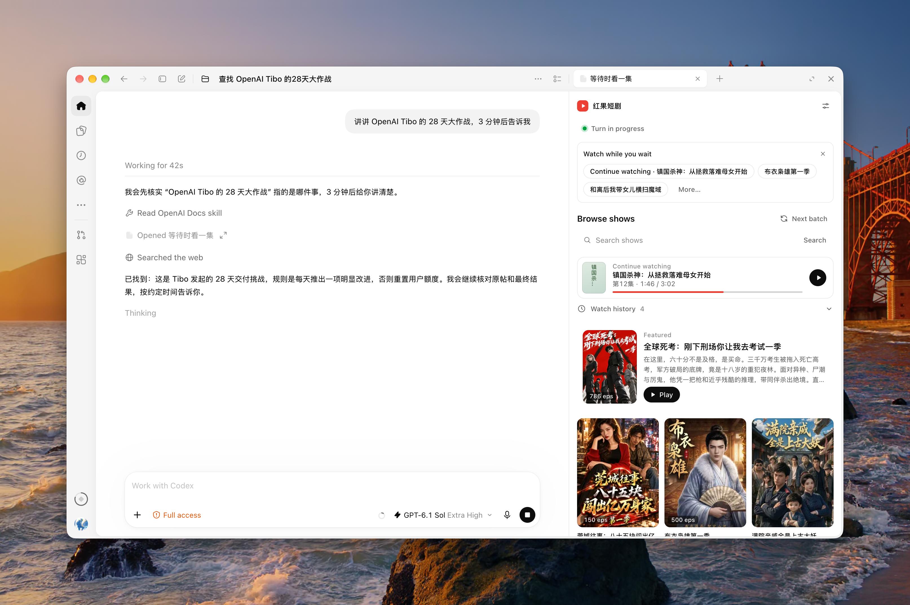
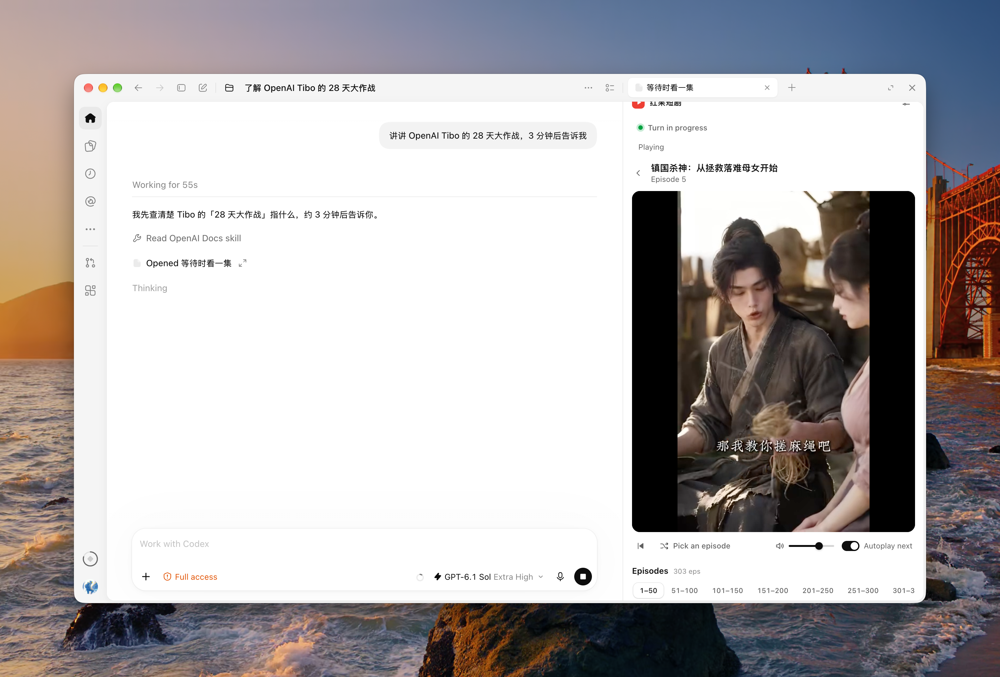

<p align="center">
  
</p>

<h1 align="center">Hongguo Short Dramas · codex-hongguo</h1>

<p align="center">Watch an episode while Codex works.</p>

<p align="center">
  <a href="README.md">中文</a> · English<br>
  <a href="#installation--setup">Installation &amp; Setup</a> · <a href="#screenshots">Screenshots</a> · <a href="#usage">Usage</a>
</p>

Watch Hongguo short dramas in the right-hand panel of Codex Desktop, with browsing, search, resume and autoplay next. By default, a new task resumes the selected episode; finishing or interrupting the task pauses playback and saves your position. You can turn off either behavior independently in Settings. The plugin supports local-executor Codex Desktop conversations.

This is an independent, unofficial plugin with original icon artwork. The red fruit echoes the name Hongguo ("red fruit"), while the leaf and play button form the plugin's own mark.

After installation and Hook review, continue working normally. The optional **Watch while you wait** card offers up to three shows per turn. It prioritizes **Continue watching**, or **Watch next** when the saved episode is complete and another episode is available. Other slots rotate unwatched shows. Clicking a title opens the player in that chat and uses your default-mute setting.

## Installation & Setup

Supports macOS, Linux (x64/arm64), Windows x64, and Windows 11 ARM64. Requires Node.js >=22.16 with npm for your architecture and a Codex CLI supporting npm plugin sources. The plugin prepares its playback component automatically; no separate FFmpeg installation is needed.

Install with npm on macOS / Linux:

```sh
npx "@kyun.si/codex-hongguo@latest" setup
```

On Windows PowerShell:

```powershell
npx.cmd "@kyun.si/codex-hongguo@latest" setup
```

Keep the package name quoted so PowerShell treats the leading `@` literally. `npx.cmd` invokes the npm command shim directly. See [Windows support](docs/windows-support.md) (Chinese) for details and offline installation.

Default installation and updates do not require Git. The command checks Node, npm and the Codex CLI, prepares the playback component, then uses a local marketplace index to install the plugin from npm. The first installation requires a network connection; later runs reuse the local cache. The installer tells you to review, trust and enable `UserPromptSubmit`, `Stop` and `Interrupt` in Codex **Settings → Hooks**. Then open a new local chat to use the plugin.

### Beta testing channel

Test devices can use beta while stable users stay on `@latest`:

```powershell
npx.cmd "@kyun.si/codex-hongguo@beta" setup
```

Update with `npx.cmd "@kyun.si/codex-hongguo@beta" update`. On macOS / Linux, use `npx` instead of `npx.cmd`. Use `@latest setup` to return to stable. Switching channels replaces the current plugin and preserves preferences and progress. Close the previous player first and restart Codex afterward; review Hooks when prompted.

### Post-Install Setup

- **Run the Setup guide**: Run **Setup** from the plugin details view (which invokes `hongguo-setup`), or say `配置红果短剧` in a local conversation. Setup checks Node, the progress database and the playback component, then shows a fixed reminder to check Hook authorization manually in Codex Settings → Hooks.
- **Review and trust Hooks**: For task-start and task-end playback control, open Codex Desktop **Settings → Hooks** (`设置 → Hooks`), review and trust Hongguo's `UserPromptSubmit`, `Stop`, and `Interrupt` hooks and confirm they are enabled. Installation and Setup show a fixed reminder; they do not query or judge Hook authorization. You can watch manually before completing Hook setup.
- **No extra accounts or permissions**: Normal browsing and playback do not require a Hongguo account, API key, or browser automation permissions.

## Screenshots

**Show catalog**: Browse recommendations, search for shows, or continue where you left off.



**Player**: Watch beside your chat, choose episodes and autoplay the next episode. Playback can start once the first local fragments are ready while the rest continue processing in the background. With autoplay next enabled, the player preloads one upcoming episode during the last roughly 30 seconds (or the final quarter of shorter episodes), reducing the wait between episodes. Preload failures do not interrupt playback.



## Usage

| Scenario | How to Open |
| --- | --- |
| Start from a task suggestion | Click a title in **Watch while you wait** during a running turn. At most one card is offered per turn; you can ignore it and continue the task. No new card is requested when suggestions are disabled or this conversation already has a visible player. |
| Watch while waiting for a task | Click **＋** on the right side of a conversation (or press `⌘T` on macOS to open a new tab), type `红果` in the address bar, and select **红果短剧**; or click **More tools…** (`更多工具…`) and choose **红果短剧** under **Plugins and MCPs** (`插件和 MCP`). The player opens on the right side of that conversation. |
| Watch independently | In Codex Desktop with the plugin installed, click [Open Hongguo Short Dramas](codex://plugins/codex-hongguo@hongguo-local/app/open_drama_panel) to open the standalone catalog. To play and pause automatically with tasks, open the player from the corresponding chat instead. |

- **Browse & resume**: The catalog shows saved titles as it refreshes. On first use, titles appear as soon as the first batch arrives. Click any show title in Recommendations, Search results, or Watch history (`观看历史`) to start playing. Previously watched shows automatically resume from your last episode and timestamp, with a banner option to **Start over** (`从头播放`). Watch history is grouped by show and supports removing individual entries.
- **Default mute & playback controls**: Turn off **Mute by default** in Settings to open new players at the last volume. When enabled, new players start muted and restore that volume when unmuted. The speaker button controls only the current player; switching episodes and resuming preserve its sound state. On-screen controls support scrubbing, playback speed (`0.75×`–`2×`), and fullscreen. The episode selector groups episodes in sets of 50 with Previous, Next, and random episode buttons.
- **Watch while waiting**: Both the conversation card and catalog can offer up to 3 titles. Choices stay fixed within a turn. Chats share local rotation records, which advance after titles become visible. Disable suggestions or edit additional search keywords in **Settings**.
- **Pause and resume.** Click the picture, center button or toolbar playback button to pause. Click again to resume from the same position, during or after a task.
- **Background playback.** Playback continues when you switch windows or tabs. When automatic pausing is enabled, a task ending or being interrupted in this chat also pauses background playback. Closing the player saves your position.
- **Local preparation and split view**: Episodes are prepared locally and sent to the side panel in small chunks. HEVC video is converted to H.264 and non-AAC audio is converted to AAC as needed, so initial preparation can take time. The regular player offers **Split view** (`分屏`) after selecting an episode; open its one-time link in the Codex built-in browser within 60 seconds. Players opened from an inline suggestion card do not show this button; open the regular player from the right-side **＋** when needed.

### Global playback settings

Open **Settings** at the top right of the player. Switches save automatically; recommendation keywords save on Enter or when leaving the field. **Close** waits for saving to finish. If saving fails, the panel stays open with a retry message.

| Setting | Default | Behavior |
| --- | --- | --- |
| Pause automatically when a task ends | On | Pause and save your position when a task in this chat finishes or is interrupted. Turn it off for continuous playback. |
| Play automatically when a task starts | On | Play the selected episode from its current position when a new task starts in the same chat. |
| Mute by default | On | Set the initial mute state for new players. Changes immediately update the current player and sync to other open players. |
| Enable decoy page | Off | When the pointer leaves the Hongguo panel, show a decoy page and pause playback. Playback resumes when the pointer returns, unless it was paused manually. |

Hover mode follows the player panel boundary: moving to the chat, another panel, or another window conceals the show title, artwork and controls. The loaded video is retained, and task-end automatic pausing still applies while covered. The cover is generated offline from built-in project tasks, technical notes, test reports and meeting notes, with varied layouts and content. Cover style in Settings offers Random, Project tasks, Technical notes, Test report and Meeting notes. Choices save and apply immediately without closing Settings. Style options are hidden when hover mode is off. A specific style is retained across openings, with new content generated for each opening and kept stable until closed. Outside clicks, Escape and Close consistently dismiss Settings; pointer movement does not. Covers follow the interface language and theme. Codex manages native tab titles and suggestion cards already present in the chat; covering the panel does not replace those.

Settings are independent, saved across restarts, and shared by all chats. Task playback switches and default mute sync to open players. The speaker button changes only the current player, leaving the default unchanged; repeated snapshots preserve that manual choice until the default changes. New players restore the remembered volume. Autoplay requires an open player with an episode selected; it does not choose a show or reopen a closed player. Manual pausing lasts for the current task; the autoplay switch determines whether the next task resumes playback. Updates preserve saved choices.

## Troubleshooting

- **No task suggestions**: Enable suggestions, trust all three Hooks, and retry in a new local turn with no visible player. If the catalog returns no candidates or the host does not display the card, use the right-side **＋** to open the player.
- **Playback component preparation failed**: Check your connection and run the installation command again. The plugin retries preparation automatically.
- **Task-linked playback is not working**: Check all three events in Codex **Settings → Hooks**. A passing environment check does not establish that automatic pausing works; manual playback remains available.

- **Playback pauses too often**: Turn off **Pause automatically when a task ends** in the player's Settings and save to keep watching continuously.
- **A new task does not resume playback**: Enable and save **Play automatically when a task starts**. Keep the player open in that chat with an episode selected. New defaults do not override a previously saved off setting.
- **A recommendation opens without playing**: During a running task, it should start muted. If that task ends before playback starts, the player asks you to click Play to continue. A host autoplay restriction is also shown explicitly.

## Updating, Disabling & Uninstalling

Close all open player panels and split-view browser tabs before updating or uninstalling. Open a new conversation to verify after managing plugins.

Update with:

```sh
npx "@kyun.si/codex-hongguo@latest" update
```

In Windows PowerShell, use `npx.cmd` instead of `npx` for the update and uninstall commands, keeping the package name quoted.

Updates preserve viewing progress and settings. Open a new chat afterward and review changed Hooks when prompted.

Uninstall with:

```sh
npx "@kyun.si/codex-hongguo@latest" uninstall
```

Uninstalling deletes the plugin's playback components, viewing progress, settings, all video caches and device profiles, including old components and partial downloads. System FFmpeg installations and external executables are kept. Open a new chat afterward. To disable the plugin temporarily while keeping data, use Codex plugin settings.

The default user data directories below are removed automatically during uninstall:

| OS | User Data Directory |
| --- | --- |
| macOS | `~/Library/Application Support/CodexHongguo/` |
| Windows | `%LOCALAPPDATA%\CodexHongguo\` (defaults to `%USERPROFILE%\AppData\Local\CodexHongguo\`) |
| Linux | `codex-hongguo` under `XDG_DATA_HOME` (defaults to `~/.local/share/codex-hongguo/`) |

Inside this folder, `player.sqlite` and its WAL/SHM files store progress, turn state, recommendation rotation, catalog and episode metadata, refresh state and settings. `media/` holds prepared full episodes, capped at 40 episodes and 1 GiB with protection for active files. `panel-media/` contains temporary panel fragments with separate cleanup; its size is outside that 1 GiB limit. `device/` holds the upstream SDK's anonymous device profile. Raw hook payloads, prompts and assistant replies are not written to disk. Third-party runtime dependency notices are under `licenses/` in the plugin root.

## Features & Limitations

| Area | Behavior & Scope |
| --- | --- |
| Host scope | Supports only Codex Desktop conversations running on the local executor; does not support cloud/remote executors or other host applications. |
| Content source & streams | Connects to the Hongguo catalog only (no multi-provider source switcher); when an episode offers multiple streams, the player selects a playable stream automatically without a manual quality selector. |
| Recommendations & search | Catalog browsing and search rely on the anonymous upstream SDK; the home view prioritizes unwatched shows in batches of up to 12 (recommendations and episode pages share a persistent 15-minute cache across chats, serve stale data while refreshing, and back off after failures) and falls back to configurable search keywords when recommendations are sparse. |
| Anonymous rate-limit recovery | When an anonymous device is rejected or streams come back empty, the SDK performs bounded retries and device resets before surfacing the failure reason with a retry action. |
| Progress persistence | Saves playback position locally every ~5 seconds while playing, as well as on pause, seek, episode change, or panel hide. |
| Turn linkage & autoplay | Task-start autoplay and task-end automatic pausing both default to on; see Global playback settings above. Autoplay next is enabled by default and remembers changes. |
| Appearance & locale | Adapts to narrow sidebars (episodes below video) and wide panels (episodes beside video), following Codex light/dark themes and Chinese/English UI locales. |

<!-- development -->

## Contributing

Development and testing instructions are in [CONTRIBUTING.md](CONTRIBUTING.md).

See [npm distribution, upgrades and publishing](docs/npm-distribution.md) for package structure and release maintenance.

## License & Credits

- **Project license**: This project is licensed under the [MIT License](LICENSE); npm metadata uses `MIT`. Bundled third-party dependency notices are under `licenses/` in the plugin root. Copyrights for drama series, covers and media streams belong to their respective rightsholders.
- **Upstream & specifications**: Inspired by [frostming/dsh-hongguo](https://github.com/frostming/dsh-hongguo), with Hongguo catalog and playback resolution powered by [openhongguo](https://github.com/beilunyang/openhongguo). Host integration follows [OpenAI Plugin Extensions](https://developers.openai.com/plugins/build/extensions), [Plugin Packaging](https://developers.openai.com/plugins/build/plugins), and [Codex Hooks](https://learn.chatgpt.com/docs/hooks).
