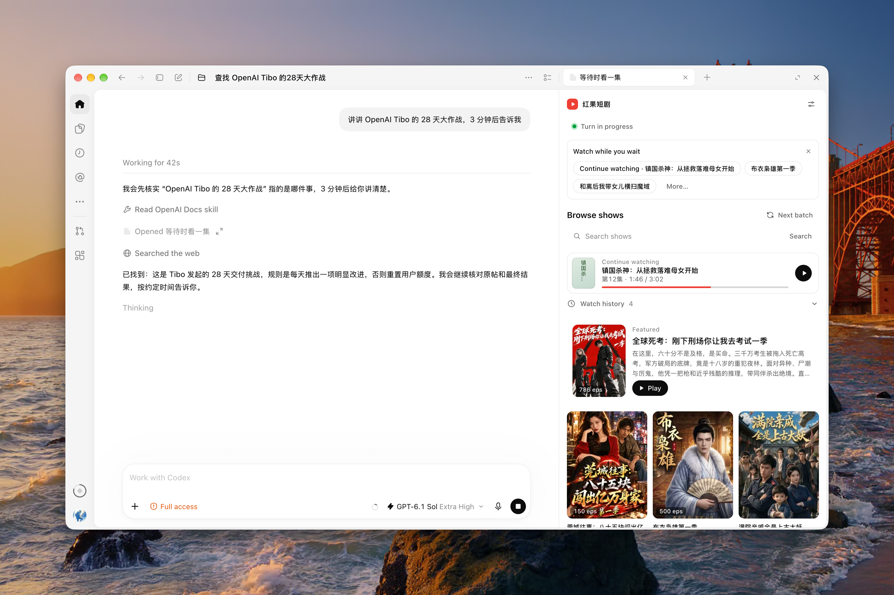

<p align="center">
  
</p>

<h1 align="center">红果短剧 · codex-hongguo</h1>

<p align="center">边等 Codex，边看一集。</p>

<p align="center">
  中文 · <a href="README.en.md">English</a><br>
  <a href="#安装与配置">安装与配置</a> · <a href="#界面预览">界面预览</a> · <a href="#观看用法">观看用法</a>
</p>

在 Codex 桌面会话右侧看红果短剧，支持选剧、搜索、续播和连播。默认在新任务开始时续播已选剧集，任务结束或中断时暂停并保存进度；两个行为都可在设置中独立关闭。插件用于使用本机执行器的 Codex 桌面对话。

内置片源为红果，也可通过 [Provider 插件](docs/providers.md) 接入本地片源。在播放器「设置 → 片源 Provider」开启插件并保存后，悬停左上角播放图标可选择已启用的片源；点击具体条目才切换。各片源的推荐、搜索、历史和缓存标识相互隔离，切换时保存进度并停止当前播放。

本项目是非官方的独立插件，图标为原创设计。红色果实呼应「红果」，叶片和播放键构成插件自己的标识。

完成安装并信任 Hooks 后，照常发任务，对话里的「等待时看一集」每轮最多推荐三部。已有进度优先显示「继续观看」；本集已看完且还有后续分集时显示「看下一集」。其余位置轮换没看过的剧，点剧名即可在当前聊天里打开播放器，按「默认静音」设置开播。

## 安装与配置

支持 macOS、Linux（x64/arm64）、Windows x64 和 Windows 11 ARM64。需要对应架构的 Node.js >=22.16（含 npm）和支持 npm 插件源的 Codex CLI。播放组件由插件自动准备，无需单独安装 FFmpeg。

macOS / Linux 使用 npm 安装：

```sh
npx "@kyun.si/codex-hongguo@latest" setup
```

Windows PowerShell 使用：

```powershell
npx.cmd "@kyun.si/codex-hongguo@latest" setup
```

包名的引号必须保留，避免 PowerShell 将 `@` 解析为展开运算符；`npx.cmd` 可直接调用 npm 命令入口。Windows 详细说明和离线安装见 [Windows 支持](docs/windows-support.md)。

默认安装和更新不需要 Git。命令会检查 Node、npm 和 Codex CLI，自动准备播放组件，再通过本机市场索引从 npm 安装插件。首次安装需要联网，之后复用本机缓存。安装完成时会提示你到 Codex「设置 → Hooks」审查、信任并启用 `UserPromptSubmit`、`Stop`、`Interrupt`。然后打开新的本地聊天使用。

### 安装后配置

- **运行设置引导（Setup）**：安装后可在插件详情页运行 **Setup**（调用 `hongguo-setup`），或在本地对话中直接说“配置红果短剧”。引导会检查 Node、进度库和播放组件，并固定提示你到 Codex「设置 → Hooks」人工核对三个 Hooks 的授权。
- **审查并信任 Hooks**：任务开始和结束联动需要你在 Codex 桌面 **设置 → Hooks** 中找到红果短剧，审查并信任 `UserPromptSubmit`、`Stop` 和 `Interrupt` 三个事件并确认已启用。安装脚本与设置引导只提供固定提示，不检测或判断 Hooks 授权状态。未完成 Hooks 配置前仍可先手动观看。
- **账号与权限**：日常浏览和观看不需要红果账号、API Key 或浏览器自动化权限。

## 界面预览

**选剧目录**：浏览推荐、搜索剧目，或继续观看上次的剧集。



**播放界面**：在聊天右侧观看，支持选集和连播。本地转码生成首批分段后即可开播，其余分段继续后台准备。开启连播时，在本集最后约 30 秒（短集的最后四分之一）后台预加载下一集，减少切集等待；只提前准备一集，失败不影响当前播放。


## 观看用法

| 观看场景 | 打开方式 |
| --- | --- |
| 从任务推荐直接开播 | 当前回合进行中时，点击对话内「等待时看一集」的剧名。每轮最多出现一张卡片；忽略即可继续原任务。推荐开关关闭或本对话已有可见播放器时，不再请求新卡片。 |
| 边等当前任务边看 | 点击对话右侧的 **＋**（macOS 也可按 `⌘T` 打开新标签页），在新标签页地址栏输入「红果」，选择结果里的 **红果短剧**；或点击「更多工具…」，在「插件和 MCP」分组下选择 **红果短剧**。播放器会在该条对话右侧打开。 |
| 只想看剧 | 在已安装插件的 Codex 桌面点击[直接打开红果短剧](codex://plugins/codex-hongguo@hongguo-local/app/open_drama_panel)，即可进入独立片库。需要随任务自动播放和暂停时，请从对应聊天右侧打开播放器。 |

- **选剧与续播**：片库打开即显示已缓存的剧名并自动刷新。首次使用时，第一批剧目返回就会显示。点击推荐、搜索结果或「观看历史」中的剧名即可开播。看过的剧会自动回到上次的集数和时间点，提示栏同时提供「从头播放」。观看历史按剧汇总，可单条移除。
- **默认静音与画面控制**：可在设置中关闭「默认静音」，新打开的播放器会恢复上次音量；开启时静音打开，取消静音后仍恢复上次音量。扬声器按钮只控制当前播放器，切集和续播保持当前声音状态。画面内支持拖动进度、切换倍速（`0.75×`–`2×`）和全屏；选集区每 50 集一组，支持上一集、下一集和随机一集。
- **等待任务时看**：对话卡片和选剧页都可提供最多 3 部快捷推荐。同一回合的剧目保持不变；多个聊天共享本地轮换记录，卡片实际显示后才计入轮换。在「设置」中可关闭推荐或修改补充搜索词。
- **暂停与续播**　点画面、中央按钮或底部播放键都能暂停，再点一次从原处继续。任务运行中和结束后都可以操作。
- **后台播放**　切换窗口或标签页时可继续观看。开启「任务结束自动暂停」时，当前对话的任务结束或中断也会暂停后台播放。关闭播放器会保存进度。
- **本机媒体准备与分屏**：整集先在本机准备，再按小块传给右侧面板。HEVC 视频会转为 H.264，非 AAC 音轨按需转为 AAC，首次准备可能需要等待。普通播放器选中分集后可通过「分屏」生成 60 秒内有效的一次性链接，在 Codex 内置浏览器观看。从对话推荐卡片打开的播放器不显示分屏按钮，需要时从右侧 ＋ 重新打开普通播放器。

### 全局播放设置

在播放器右上角打开「设置」，修改后点击「保存设置」。

| 设置 | 默认 | 行为 |
| --- | --- | --- |
| 任务结束自动暂停 | 开启 | 当前聊天的任务结束或中断时暂停并保存进度；关闭后持续播放。 |
| 任务开始自动播放 | 开启 | 同一聊天的新任务开始时，从原位置播放已选中的剧集。 |
| 默认静音 | 开启 | 新打开播放器时按此设置决定是否静音；修改后立即同步当前播放器，其他已打开的播放器也会自动同步。 |

设置独立保存，所有聊天共用。任务播放开关和默认静音会同步到已打开的播放器。扬声器按钮只改变当前播放器的静音状态，不修改默认值；未修改默认静音时，同步不会覆盖手动选择。新打开播放器时恢复记住的音量。自动播放需要播放器保持打开且已有选中的剧集；它不会自动选剧或重新打开已关闭的播放器。手动暂停在当前任务内保持有效，下一轮是否续播取决于自动播放开关。升级会保留已保存的选择。

## 排查问题

- **没有任务推荐**：确认推荐开关已开启、三个 Hooks 已信任，并在没有可见播放器的新本地回合中重试。片库没有返回候选或宿主未展示卡片时，仍可从右侧 ＋ 打开播放器。
- **播放组件准备失败**：检查网络后重新运行安装命令，插件会自动重试准备。
- **回合联动未生效**：到 Codex「设置 → Hooks」核对三个事件。环境检查通过不等于回合联动已生效；未完成时可先手动观看。
- **任务结束时频繁暂停**：在播放器「设置」中关闭「任务结束自动暂停」并保存，即可持续播放。
- **新任务开始没有续播**：确认「任务开始自动播放」已开启并保存，且播放器在对应聊天中保持打开、已选中剧集。新默认值不会覆盖此前手动保存的关闭设置。
- **点推荐后没有开播**：任务仍在执行时应自动静音播放；如果推荐所属任务在开播前已结束，会提示点击播放继续。宿主限制自动播放时，也会显示明确提示。

## 更新、禁用与卸载

更新或卸载前，请先关闭所有播放器面板和内置浏览器分屏；管理插件后请使用新会话验证。

更新命令：

```sh
npx "@kyun.si/codex-hongguo@latest" update
```

Windows PowerShell 将上述更新和卸载命令中的 `npx` 写为 `npx.cmd`，并保留包名引号。

更新会保留观看进度和设置。完成后打开新聊天，并按提示重新审查 Hooks。

卸载命令：

```sh
npx "@kyun.si/codex-hongguo@latest" uninstall
```

卸载会删除本插件的播放组件、观看进度、设置、全部视频缓存和设备档案，包括历史组件和下载残片；系统或外部自行配置的 FFmpeg 不会删除。完成后打开新聊天。只想暂时停用并保留数据时，可从 Codex 插件设置中禁用。

以下默认用户数据目录会在卸载时自动删除：

| 系统 | 用户数据目录 |
| --- | --- |
| macOS | `~/Library/Application Support/CodexHongguo/` |
| Windows | `%LOCALAPPDATA%\CodexHongguo\`（缺省为 `%USERPROFILE%\AppData\Local\CodexHongguo\`） |
| Linux | `XDG_DATA_HOME` 下的 `codex-hongguo`（缺省为 `~/.local/share/codex-hongguo/`） |

目录内 `player.sqlite`（及其 WAL/SHM 文件）保存观看进度、回合状态、推荐轮换、片库与分集元数据、刷新状态及播放器设置；`media/` 保存本机处理后的整集缓存（上限 40 集、1 GiB，活动文件有保护期）；`panel-media/` 保存单独回收的临时面板分片，其占用不计入整集缓存的 1 GiB 上限；`device/` 为上游 SDK 管理的匿名设备档案。本插件不将 Hook 原始输入、提示词和模型回复写入磁盘。第三方运行时依赖的许可证位于插件根目录 `licenses/`。

## 功能与限制

| 项目 | 说明与限制 |
| --- | --- |
| 适用宿主 | 仅支持 Codex 桌面客户端中使用本机执行器的对话，不适用于云端/远程执行器或其他宿主环境。 |
| 片源与选流 | 内置红果和 Bilibili 番剧，默认只启用红果；在设置开启哔哩哔哩，悬停图标后选择片源，粘贴 ss/ep 番剧链接进入分集。B 站暂不支持关键词搜索；首次播放先缓存整集，试看和 DRM 会拒绝。详见 [Provider 插件](docs/providers.md)。 |
| 推荐与搜索 | 片库与搜索依赖匿名上游 SDK；首页优先推荐未看过的剧，每批最多 12 部（推荐与分集缓存 15 分钟，跨对话共享；过期先使用已有内容并后台刷新，失败后逐步延长重试间隔），推荐不足时按设置中的补充关键词搜索。 |
| 匿名限流与恢复 | 匿名设备被拒或片源为空时，SDK 会按有限次数自动重试与恢复；仍失败时在界面显示原因供手动重试。 |
| 进度保存 | 播放期间每约 5 秒自动保存一次进度，暂停、拖动、换集或隐藏面板时也会立即保存。 |
| 回合联动与连播 | 任务开始自动播放、任务结束自动暂停均默认开启，详见「全局播放设置」。连播默认开启，当前集播完自动播放下一集；关闭后也会记住。 |
| 外观与语言 | 选剧页与播放器跟随 Codex 浅色/深色外观及中英文界面；窄侧栏在画面下方显示选集栏，宽面板将选集栏置于画面右侧。 |

<!-- development -->

## 贡献与开发

开发与测试说明见 [CONTRIBUTING.md](CONTRIBUTING.md)。

npm 包结构、升级与发布流程见 [npm 分发说明](docs/npm-distribution.md)。

## 许可证与致谢

- **项目许可证**：原有项目代码保留 [MIT 许可证](LICENSE)。包含 GPL SDK amagi 的组合发行包按 [GPL-3.0-only](COPYING) 分发，附项目对应源码 ZIP、固定修订的 SDK 原始源码及第三方许可。短剧剧目与媒体内容的版权归原权利人所有。
- **上游与参考资料**：项目灵感来自 [frostming/dsh-hongguo](https://github.com/frostming/dsh-hongguo)，红果片库与播放解析使用 [openhongguo](https://github.com/beilunyang/openhongguo)，宿主扩展接口依据 [OpenAI 插件扩展](https://developers.openai.com/plugins/build/extensions)、[插件打包](https://developers.openai.com/plugins/build/plugins) 和 [Codex Hooks](https://learn.chatgpt.com/docs/hooks)。
