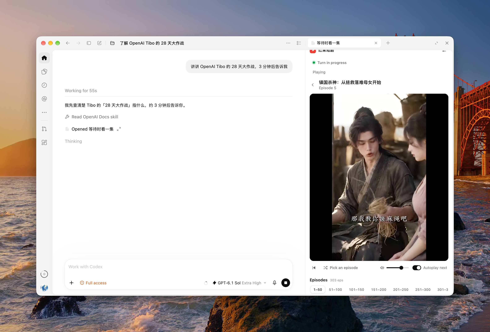

# 红果短剧 (codex-hongguo)

中文 · [English](README.en.md)

在 Codex 桌面会话右侧看红果短剧，边看边等任务。默认在新任务开始时续播已选剧集，任务结束或中断时暂停并保存进度；两个行为都可在设置中独立关闭。插件用于使用本机执行器的 Codex 桌面对话。

完成安装并信任 Hooks 后，照常发任务，对话里的「等待时看一集」每轮最多推荐三部。已有进度优先显示「继续观看」；本集已看完且还有后续分集时显示「看下一集」。其余位置轮换没看过的剧，点剧名即可在当前聊天里打开播放器并静音开播。



## 观看用法

| 观看场景 | 打开方式 |
| --- | --- |
| 从任务推荐直接开播 | 当前回合进行中时，点击对话内「等待时看一集」的剧名。每轮最多出现一张卡片；忽略即可继续原任务。推荐开关关闭或本对话已有可见播放器时，不再请求新卡片。 |
| 边等当前任务边看 | 点击对话右侧的 **＋**（macOS 也可按 `⌘T` 打开新标签页），在新标签页地址栏输入「红果」，选择结果里的 **红果短剧**；或点击「更多工具…」，在「插件和 MCP」分组下选择 **红果短剧**。播放器会在该条对话右侧打开。 |
| 只想看剧 | 在已安装插件的 Codex 桌面点击[直接打开红果短剧](codex://plugins/codex-hongguo@hongguo-local/app/open_drama_panel)，即可进入独立片库。需要随任务自动播放和暂停时，请从对应聊天右侧打开播放器。 |

- **选剧与续播**：片库打开即显示已缓存的剧名并自动刷新。首次使用时，第一批剧目返回就会显示。点击推荐、搜索结果或「观看历史」中的剧名即可开播。看过的剧会自动回到上次的集数和时间点，提示栏同时提供「从头播放」。观看历史按剧汇总，可单条移除。
- **默认静音与画面控制**：打开播放器时默认静音，点击扬声器或调整音量滑块即可出声。画面内支持拖动进度、切换倍速（`0.75×`–`2×`）和全屏；选集区每 50 集一组，支持上一集、下一集和随机一集。
- **等待任务时看**：对话卡片和选剧页都可提供最多 3 部快捷推荐。同一回合的剧目保持不变；多个聊天共享本地轮换记录，卡片实际显示后才计入轮换。在「设置」中可关闭推荐或修改补充搜索词。
- **暂停与续播**　点画面、中央按钮或底部播放键都能暂停，再点一次从原处继续。任务运行中和结束后都可以操作。
- **后台播放**　切换窗口或标签页时可继续观看。开启「任务结束自动暂停」时，当前对话的任务结束或中断也会暂停后台播放。关闭播放器会保存进度。
- **本机媒体准备与分屏**：整集先在本机准备，再按小块传给右侧面板。HEVC 视频会转为 H.264，非 AAC 音轨按需转为 AAC，首次准备可能需要等待。普通播放器选中分集后可通过「分屏」生成 60 秒内有效的一次性链接，在 Codex 内置浏览器观看。从对话推荐卡片打开的播放器不显示分屏按钮，需要时从右侧 ＋ 重新打开普通播放器。

### 全局播放设置

在播放器右上角打开「设置」，修改后点击「保存设置」。

| 设置 | 默认 | 行为 |
| --- | --- | --- |
| 任务结束自动暂停 | 开启 | 当前聊天的任务结束或中断时暂停并保存进度；关闭后持续播放。 |
| 任务开始自动播放 | 开启 | 同一聊天的新任务开始时，从原位置播放已选中的剧集。 |

两个开关独立保存，所有聊天共用，其他已打开的播放器会同步设置。自动播放需要播放器保持打开且已有选中的剧集；它不会自动选剧或重新打开已关闭的播放器。手动暂停在当前任务内保持有效，下一轮是否续播取决于自动播放开关。升级会保留已保存的选择。

## 安装与配置

需要 macOS 或 Linux、Node.js >=22.16（含 npm）、支持 npm 插件源的 Codex CLI，以及 FFmpeg（建议 >=8）。macOS 可用 `brew install node ffmpeg` 安装依赖。本机验收使用 Codex CLI 0.157.1；Linux 尚待桌面实机验收。Windows x64 原生启动器已随离线包提供，当前为试用，npm 安装限制将在实机验收通过后开放；见 [Windows 试用说明](docs/windows-support.md)。

npm 正式发行包已发布。安装与更新通过 Codex 原生插件市场完成。

### 从源码构建

除运行依赖外，构建还需要 Go >=1.25，用于生成 Windows 启动器。

```sh
git clone https://github.com/mreasonyang/codex-hongguo.git
cd codex-hongguo
npm ci
npm run package
```

构建会生成 `release/codex-hongguo-<版本号>/` 和同名 ZIP。进入生成的目录，按下一节的命令安装；完整开发说明见 [CONTRIBUTING.md](CONTRIBUTING.md)。

### 离线包

将 `codex-hongguo-<版本号>.zip` 解压到长期保留的目录；若刚从源码构建，可直接进入生成的 `release/codex-hongguo-<版本号>/`。在该目录运行：

```sh
node plugins/codex-hongguo/bin/codex-hongguo.mjs setup --marketplace .
```

离线包与 npm 包使用同一构建产物，启动器自动发现运行环境。离线更新时重复上述命令，将 `--marketplace` 指向新版解压目录。自定义来源的后续安装或更新也应显式带上此参数；省略时会选择默认 GitHub 市场。

### 在线安装

使用 npm 安装：

```sh
npx @kyun.si/codex-hongguo@latest setup
```

向导检查运行环境，再通过 Codex 原生市场安装确定版本的完整插件包。包内包含 JavaScript 依赖、播放器和 WASM；Node、npm 与 FFmpeg 仍需本机准备，启动器会自动寻找程序。安装完成后打开新的本地聊天，运行插件 Setup 并审查 Hooks。

### 安装后配置

- **运行设置引导（Setup）**：安装后可在插件详情页运行 **Setup**（调用 `hongguo-setup`），或在本地对话中直接说“配置红果短剧”。引导会检查 Node、进度库、FFmpeg，以及本插件三个 Hooks 是否已信任并启用。
- **播放器使用指南**：播放器首次打开会显示使用指南，点击「开始选剧」可收起指南。更新后如有 Hooks 待审查，指南会再次提示。之后可随时从「设置 → 使用指南」重开并点击「重新检查」，也可在「设置 → 自检」查看本机运行环境。
- **审查并信任 Hooks**：任务开始和结束联动需要你在 Codex 桌面 **设置 → Hooks** 中找到红果短剧，审查并信任 `UserPromptSubmit`、`Stop` 和 `Interrupt` 三个事件，完成后重新检查。安装脚本与设置引导不会替用户自动信任 Hooks，也不会把历史回合记录当成配置成功；读取不到宿主信任状态时会显示「待确认」。未完成 Hooks 配置前仍可先手动观看。
- **账号与权限**：日常浏览和观看不需要红果账号、API Key 或浏览器自动化权限。

### 排查问题

- **没有任务推荐**：确认推荐开关已开启、三个 Hooks 已信任，并在没有可见播放器的新本地回合中重试。片库没有返回候选或宿主未展示卡片时，仍可从右侧 ＋ 打开播放器。
- **找不到 FFmpeg**：安装后重启 Codex，再从播放器「设置 → 使用指南」重新检查。
- **回合联动显示「待确认」**：到 Codex「设置 → Hooks」核对三个事件。环境检查通过不等于回合联动已生效；未完成时可先手动观看。
- **任务结束时频繁暂停**：在播放器「设置」中关闭「任务结束自动暂停」并保存，即可持续播放。
- **新任务开始没有续播**：确认「任务开始自动播放」已开启并保存，且播放器在对应聊天中保持打开、已选中剧集。新默认值不会覆盖此前手动保存的关闭设置。

### 更新、禁用与卸载

更新或卸载前，请先关闭所有播放器面板和内置浏览器分屏；管理插件后请使用新会话验证。

离线安装按「离线包」一节更新。在线更新命令为：

```sh
npx @kyun.si/codex-hongguo@latest update
```

上述命令用于在线安装，原生更新也可用 `codex plugin marketplace upgrade hongguo-local`。向导沿用 `codex-hongguo@hongguo-local` 标识；从旧 ZIP 迁移到在线来源时替换市场，失败会尝试恢复原来源，观看数据保留在原目录。可以先用 `setup --dry-run` 查看计划；预览同样会检查运行环境。更新后使用新聊天，并检查 Hooks 是否需要重新审查。

- **禁用与卸载**：可从插件设置中禁用，或运行 `codex plugin remove codex-hongguo@hongguo-local` 卸载。卸载后可按需保留或手动清理以下专用数据目录：

| 系统 | 用户数据目录 |
| --- | --- |
| macOS | `~/Library/Application Support/CodexHongguo/` |
| Windows x64（试用） | `%LOCALAPPDATA%\CodexHongguo\` |
| Linux | `XDG_DATA_HOME` 下的 `codex-hongguo`（缺省为 `~/.local/share/codex-hongguo/`） |

目录内 `player.sqlite`（及其 WAL/SHM 文件）保存观看进度、回合状态、推荐轮换与播放器设置；`media/` 保存本机处理后的整集缓存（上限 40 集、1 GiB，活动文件有保护期）；`panel-media/` 保存单独回收的临时面板分片，其占用不计入整集缓存的 1 GiB 上限；`device/` 为上游 SDK 管理的匿名设备档案。本插件不将 Hook 原始输入、提示词和模型回复写入磁盘。第三方运行时依赖的许可证位于插件根目录 `licenses/`。

## 功能与限制

| 项目 | 说明与限制 |
| --- | --- |
| 适用宿主 | 仅支持 Codex 桌面客户端中使用本机执行器的对话，不适用于云端/远程执行器或其他宿主环境。 |
| 片源与选流 | 仅接入红果短剧单片源（不含多片源切换）；同一集存在多档媒体流时由播放器自动选流，不提供手动清晰度切换。 |
| 推荐与搜索 | 片库与搜索依赖匿名上游 SDK；首页优先推荐未看过的剧，每批最多 12 部（推荐缓存 15 分钟），推荐不足时按设置中的补充关键词搜索。 |
| 匿名限流与恢复 | 匿名设备被拒或片源为空时，SDK 会按有限次数自动重试与恢复；仍失败时在界面显示原因供手动重试。 |
| 进度保存 | 播放期间每约 5 秒自动保存一次进度，暂停、拖动、换集或隐藏面板时也会立即保存。 |
| 回合联动与连播 | 任务开始自动播放、任务结束自动暂停均默认开启，详见「全局播放设置」。连播默认开启，当前集播完自动播放下一集；关闭后也会记住。 |
| 外观与语言 | 选剧页与播放器跟随 Codex 浅色/深色外观及中英文界面；窄侧栏在画面下方显示选集栏，宽面板将选集栏置于画面右侧。 |
| 验证范围 | macOS 本地回归、隔离 npm/npx 安装与旧来源迁移、真实宿主片库/分集及分片解码已验证。跨平台 CI 状态见 [GitHub Actions](https://github.com/mreasonyang/codex-hongguo/actions)。Windows/Linux 桌面实机与自然任务联动的完整验收仍待完成；GitHub Releases 安装包尚未发布。 |

<!-- development -->

## 贡献与开发

源码构建、自动测试、内测包打包脚本、安装验证环境变量及版本管理规则已移至 [CONTRIBUTING.md](CONTRIBUTING.md)。

npm 包结构、升级与发布流程见 [npm 分发说明](docs/npm-distribution.md)。

## 许可证与致谢

- **项目许可证**：本项目采用 [MIT 许可证](LICENSE)，npm 元数据标记为 `MIT`。第三方运行时依赖的许可声明随插件根目录 `licenses/` 分发。短剧剧目与媒体内容的版权归原权利人所有。
- **上游与参考资料**：项目灵感来自 [frostming/dsh-hongguo](https://github.com/frostming/dsh-hongguo)，红果片库与播放解析使用 [openhongguo](https://github.com/beilunyang/openhongguo)，宿主扩展接口依据 [OpenAI 插件扩展](https://developers.openai.com/plugins/build/extensions)、[插件打包](https://developers.openai.com/plugins/build/plugins) 和 [Codex Hooks](https://learn.chatgpt.com/docs/hooks)。
