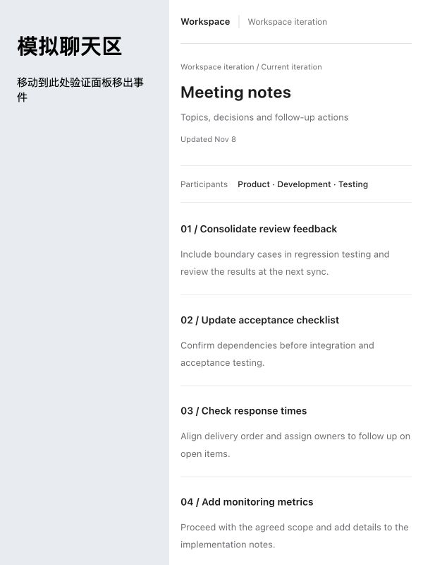
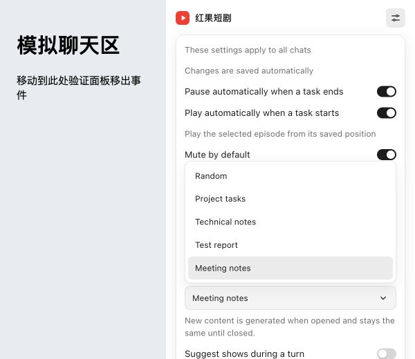

# Cover picker focus regression — local beta.10 candidate

The fix is installed locally as `0.0.35-beta.10`. **It has not been published to
npm.** The user confirmed that the menu no longer flickers in a new Codex chat,
then reported a new issue: changing style, clicking elsewhere to dismiss Settings,
and leaving the panel required an extra entry/exit before the cover appeared.
The locally installed candidate includes the follow-up fix below. The user
confirmed it works in Codex and authorized beta publication. Release still requires
the source-bound macOS, Linux and Windows qualification workflow.

## Follow-up: first exit after dismissing Settings

The original coordinate guard was too broad: it filtered genuine root/document
leave events as well as bubbling events from removed menu options. Only bubbling
`pointerout`/`mouseout` events now require outside coordinates. A root
`pointerleave` or document `mouseleave` conceals immediately, including when it
contains the last in-panel coordinates. The player root has a minimum height of
the viewport so collapsing Settings cannot turn lower blank space into a false
root departure. Waiting cards keep their content-driven height.

- Two regression cases run the actual settings and playback controllers through
  selection, outside-click dismissal, and first exit with last in-panel coordinates.
  Both fail with the original guard and pass with the fix. Polling cannot reveal
  the covered player; returning once resumes as expected.
- Native Brave mouse input passed all five choices followed by dismissal and first
  departure. All five recorded cover transitions had Settings closed.
- In the in-app browser, a pure mouse move into lower blank space kept the player
  visible; the first move out, without clicking outside, showed the selected cover.
- Full regression: 238 tests, 231 passed, seven platform skips, zero failures.
- Local setup succeeded. Installed files match the tested bundle; preferences and
  progress were preserved. UI resource v29 invalidates the preceding candidate UI.

See [current verification](dismiss-exit-verification.json),
[before/after regressions](dismiss-exit-regression.json),
[native trace](dismiss-exit-native-trace.json), and
[in-app proof](dismiss-exit-in-app-proof.json).

The remaining sections describe the preceding menu fix and its earlier evidence;
their UI hash is superseded by the current verification.

## Changes

- The cover style picker now renders a listbox inside the panel document. Opening
  it does not invoke an operating-system picker outside the iframe. The keyboard
  model follows the [select-only combobox pattern](https://www.w3.org/WAI/ARIA/apg/patterns/combobox/examples/combobox-select-only/):
  navigation retains the current value until committed, and Escape cancels the
  menu before another Escape can dismiss Settings.
- Preference polling preserves the open popup and highlighted choice.
- `mouseout`/`pointerout` without a related target is no longer sufficient to
  conceal the player: coordinates must actually be outside its viewport. Genuine
  exits, window blur and page hiding still conceal it.
- Global dismissal ignores concealed content. A press that starts on the cover
  cannot become a settings-dismissal click if reveal completes before release.
- Menus fit the iframe viewport and open upward when there is insufficient room
  below. The actual hover concealment delay was not increased to mask the issue.

## Observed final-candidate tests

The fixture serves the production UI with disposable SQLite data and synthetic
media. Passive test-only event recording observes cover changes, pointer exits,
blur, menu state and settings state. It does not alter input handling.

| Check | Result |
| --- | --- |
| Native Brave mouse input | Two consecutive rounds through all five choices: 10 successful selections; Settings stayed visible. |
| Event recording during those choices | No concealment, no blur and no settings dismissal. |
| Native keyboard input | Arrow navigation survived several polls; Escape canceled the popup without committing or closing Settings. |
| Genuine iframe exit | Concealed normally; returning once retained the open Settings sheet. |
| Narrow panel | At 360×520 CSS pixels, popup opened above, with bounds x=27…333, y=232.78…409.77, entirely inside the iframe. |
| Toggle linkage | Disabling hover hid the picker; reopening Settings and enabling hover retained the chosen style. |
| Outside click | Dismissed visible Settings consistently with hover disabled. |
| Save failure/recovery | Failure retained the chosen value and sheet, with an error; after restoring saves, retry closed normally and retained the value. |
| Automated regression | 236 tests: 229 passed, seven platform-specific skips, zero failures. |

An intermediate pointer run failed and was not accepted. The final pointer and
boundary runs were repeated after the viewport-exit and cover-click guards were
corrected. See [final verification](verification.json),
[pointer trace](pointer-trace-fixed.json) and [boundary trace](boundary-trace-fixed.json).
The production UI hashes in the final verification match both the tested bundle
and the locally installed candidate.

## Preceding host check (superseded by acceptance above)

Computer Use denies direct access to the Codex host application. Its supported
MCP App interface showed that the existing chat was still running beta.9's
native `SELECT` and that Settings could remain logically open behind the hover
cover. Reopening that old chat's panel does not establish candidate acceptance.
The user must open a new local chat to load beta.10 and verify the actual panel.
No new npm beta tag or publication has been performed for this candidate.
