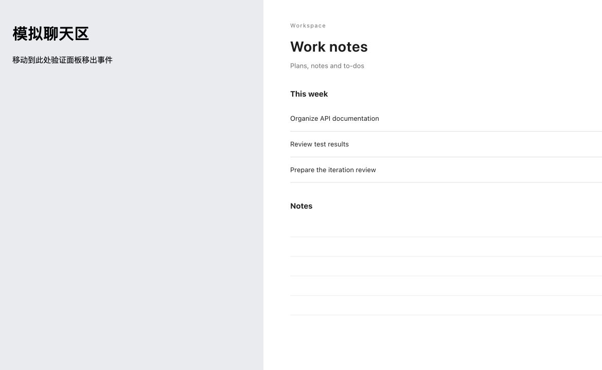

# 悬停替身实现与验收

日期：2026-11-08（Asia/Shanghai）

分支：`feat/hover-decoy-page`，基于 `main` 的 0.0.34；本次未递增发布版本、未发布，也未替换用户已安装插件。

## 已实现

- 全局设置新增“悬停时显示播放器”，默认关闭；“替身网页”留空时使用内置工作笔记页。
- 鼠标离开红果面板时同步遮盖品牌、剧名、封面、选集、设置和播放控件，暂停并保存进度；进入约 150 ms 后展示并按原有意图续播。移动到聊天区即视为离开面板。
- 保留 video/HLS 实例。手动暂停、Stop、Interrupt、关闭、切集等操作撤销过期续播意图；自动播放、后台恢复、媒体播放事件及迟到准备结果不能绕过遮盖状态。
- 同时处理窗口失焦、页面隐藏、拖动控件时的指针捕获；恢复焦点本身不揭开替身。
- 使用包含播放器和替身的共同全屏根节点，避免原生全屏把替身挡在外面；CSS 扩展全屏也保留遮盖层。
- 自定义网址仅接受无用户名/密码的 HTTP/HTTPS URL，声明精确 frame origin。开关或域名变化产生新的 MCP UI 资源 URI，向宿主通知工具元数据更新，旧 URI 保持原来的显示与 CSP 策略。
- 连接并读取设置前先显示默认替身，避免复用缓存资源时闪出红果界面。新域名尚未被当前页面允许时继续使用内置替身，保存后明确提示重新打开。
- 中英文界面与 README 已更新；旧设置自动补默认值，旧 UI URI 仍可读取。

## 测试结果

| 检查 | 结果 |
| --- | --- |
| TypeScript / 构建 | 通过 |
| 全量 `npm test` | 165 项：159 通过、0 失败、6 项 Windows 专属检查跳过 |
| 播放状态回归 | 覆盖移出/移回、手动暂停保持、任务停止/中断、隐藏时新任务、指针捕获、迟到的偏好/媒体准备/play Promise、关闭及禁用功能 |
| 真实 MCP stdio 协议 | 验证配置保存、资源 URI 随开关/域名变化、精确域名 CSP、旧 URI 策略不被后续设置放宽、内置替身与旧 URI |
| `npm run package` | 生成本地 npm tgz 和离线 ZIP，通过 |
| `npm run verify:install` | 隔离配置内全新安装、重复安装、宿主资源识别、真实片库/分集、进度保留、卸载与重复卸载通过 |
| `git diff --check` | 通过 |

全量测试摘要见 [test-summary.json](test-summary.json)。隔离安装回执由脚本写入本地 `release/verification.json`，该文件及候选包不加入 Git。安装验证不代表桌面画面、声音或 Hooks 信任状态已通过。

## 浏览器界面证据

采用用户指定的内置 @Browser，测试 `scripts/verify-hover-decoy-ui.mjs` 提供的正式构建 HTML、真实 BrowserServer、Service 和临时 SQLite。视频是仓库本地合成测试片延长至约两分钟，不请求用户观看数据或实际红果视频。

普通浏览器界面实测：播放到 4.743 秒，移出后暂停在 4.750 秒；移回后继续到 9.795 秒。手动暂停后再次移出/移入仍暂停在 9.856 秒。自定义本机网页在重新加载后显示，清空网址后恢复内置页面。原生全屏通过 `#playerRoot:fullscreen` 确认，替身可见且播放器内容不可见。记录见 [observations.json](observations.json)。

另将正式 HTTP 播放器放入与宿主不同 origin 的 sandbox iframe，旁边放置模拟聊天区。采用实际页面坐标输入：视频播放后移到聊天区，子页面 `covered=true`、视频暂停在 4.469 秒；移回后续播，之后再次移出暂停在 21.942 秒。记录见 [nested-observations.json](nested-observations.json)。

最终画面范围复核确认：左侧模拟聊天区仍可见，只有右侧播放面板显示替身。记录见 [scope-observation.json](scope-observation.json)。



其他截图：[恢复播放](player-resumed.jpg)、[自定义网页](custom-cover.jpg)、[全屏替身](fullscreen-cover.jpg)。浏览器 DOM 截图接口的部分图像只合成了播放器图层；范围复核图使用原生截图接口保留了宿主聊天区。

这些证据验证了浏览器和跨源 iframe 的行为，**不等于已在 Codex 主窗口的真实 MCP App 面板完成实机验收**。此次没有在用户实际安装的插件中验证自然回合联动，也没有对 Windows/Linux 桌面界面作实机结论。

## 使用及限制

在播放器设置中开启“悬停时显示播放器”并保存。默认使用内置工作笔记，所有聊天共用设置。自定义网站换域名后需重新打开播放器；同一域名下更换页面可直接应用。

目标网站仍可禁止 iframe、阻止登录或在 sandbox 中无法运行。iframe 的 `load` 事件不能证明加载成功，因此本实现不宣称能自动识别所有失败并回退；清空网址即可恢复默认替身。宿主若拒绝批准声明的嵌入域名，会继续显示内置替身。

遮盖只替换插件面板内容，Codex 原生标签名称和聊天内已有的推荐卡片不受它控制。浏览器拒绝无点击续播时仍需手动点击播放。

## 复现

```sh
npm ci
npm test
node --no-warnings scripts/verify-hover-decoy-ui.mjs
```

脚本打印三个无能力值的本机地址，分别用于普通播放器、测试替身网页和嵌套面板。它使用临时数据目录，不访问个人配置和进度；按 Ctrl-C 关闭时清理临时数据。此次所有测试服务和临时浏览器标签均已关闭。
