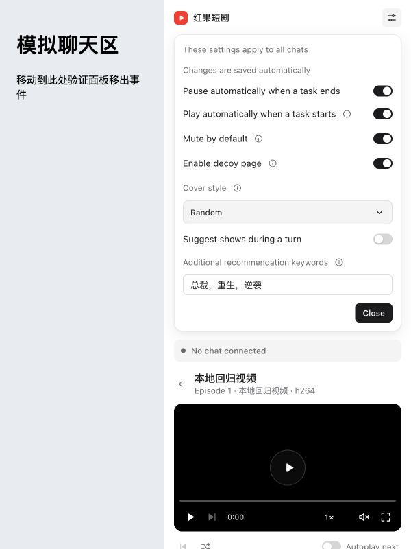

# Settings help — beta.11 local qualification

Settings descriptions now live behind information buttons beside their labels.
Hover, keyboard focus and click reveal the explanation inside the panel document.
Escape dismisses help before the style menu or Settings. Saving and error messages
remain visible. The decoy switch title and description use the user's exact Chinese
and English copy; both READMEs use the updated wording.

## Evidence

- Full regression: 241 tests, 234 passed, seven platform skips, zero failures.
- In-app browser: all five information buttons revealed their explanation without
  closing Settings or concealing the player. The pointer could move into the
  explanation; Escape dismissed it while retaining Settings.
- After help, the style picker opened and saved a report choice. An outside click
  closed Settings; the first pointer exit showed the report cover.
- In a 300×340 panel, the long explanation stayed within x=12…288 and
  y=134.40…252.38. Keyboard navigation scrolled to the keyword help and retained
  both its explanation and Settings.
- Chinese/English translation outputs matched the requested strings exactly.
- The local beta.11 installation succeeded, retained preferences and progress,
  and matched the tested UI hash. The shared UI resource is v30.

These checks use the production bundle with synthetic media and disposable fixture
data. They are browser and automated evidence; direct native Codex host interaction
was not recorded for this change. The user requested beta publication after the
local candidate was installed. The release workflow separately qualifies the
tagged archive on macOS, Linux and Windows before npm publication.

See [UI observations](ui-proof.json) and [local installation](local-install-proof.json).
The local receipt records the unpublished candidate before the release workflow.

