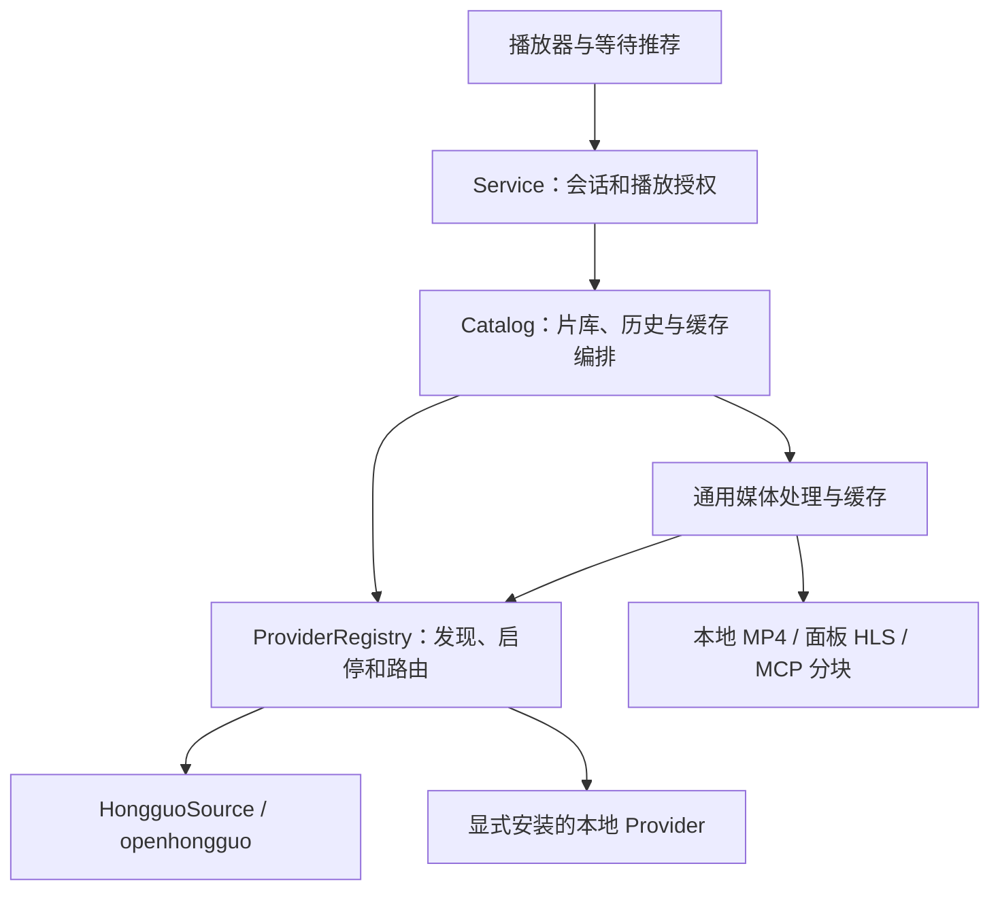

# 视频源适配层与 Provider 插件

当前实现内置红果和基于 amagi 的 Bilibili 番剧 Provider，默认只启用红果。新增来源通过显式安装的本地 Provider 扩展，详细接口见 [Provider 插件](../providers.md)。

## 依赖方向

## 保留的抽象

- Provider 统一实现浏览、详情、分集、封面和播放描述五个方法。
- 红果保留原有 `hg-*` ID，本地 Provider 使用带来源和资源类型的限定 ID。
- 注册表负责内置／本地插件发现、接口校验、启用配置、失败隔离和生命周期。
- 默认只启用红果；本地插件经设置手动开启后才执行入口，配置持久化并同步其他聊天。
- 多源时悬停图标展开浮层，点击具体片源才切换。切换保存进度，释放旧播放，拒绝晚到结果。
- 推荐、历史和缓存按 Provider 隔离。不可用或已移除的默认来源回退到红果。
- 文件、HLS、DASH、AES-128 与 CENC 由通用媒体层处理，业务逻辑不依赖具体站点。
- 本地 Provider 是显式信任的进程内代码，不构成代码沙箱。

## 验证

`npm test` 覆盖红果兼容、独立本地示例插件、配置启停和进程重启、跨来源隔离、切源竞态、历史与缓存、通用媒体及回合联动。真实红果安装和媒体验证使用 `npm run verify:install -- --playback`。

旧双源实现的验证快照保留在 `docs/audits/` 供追溯，不能代表当前支持范围；对应站点驱动、vendored SDK 和专用取流脚本已经移除。
