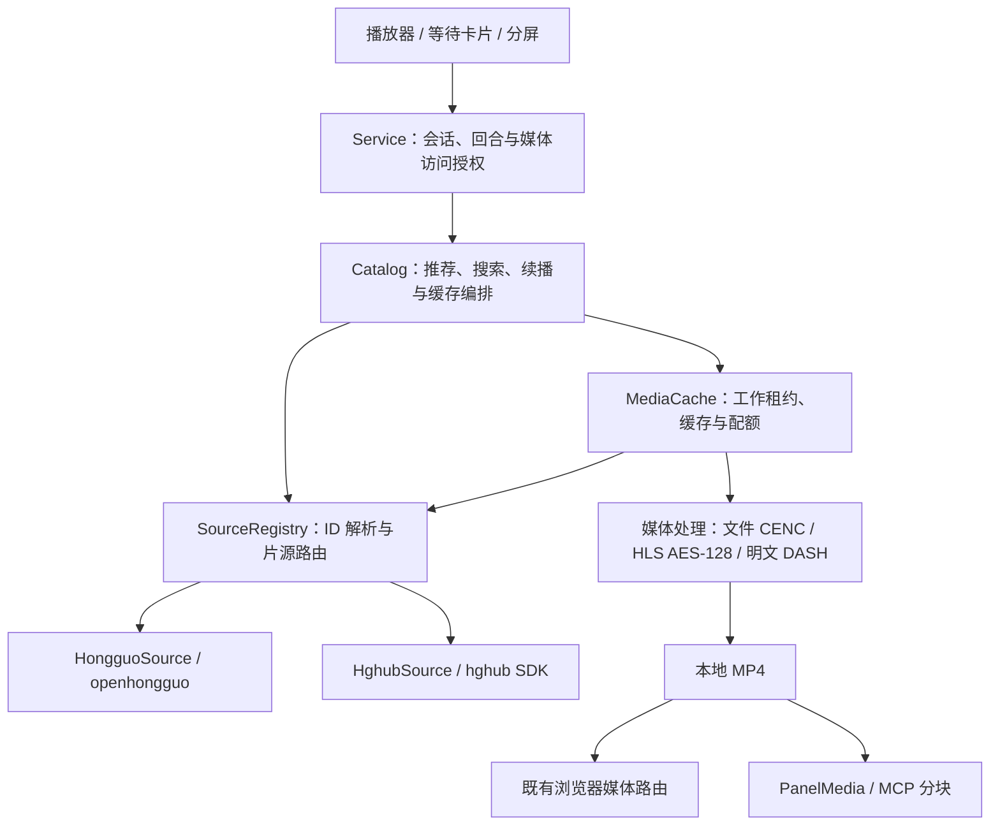

# 视频源适配层与黄果接入方案

日期：2026-11-08（Asia/Shanghai）。状态：已在 `feat/video-source-adapters` 实施；后续范围增加内置与本地 Provider 插件。最终接口与安装方式以 [Provider 插件](../providers.md) 为准，实施证据见 [实施验收](../audits/2026-11-08-provider-implementation/README.md)。下文保留最初方案及其验证边界。

基线：codex-hongguo `5033523ca1a39bfb01ac3ad447fe788aa4db99a4` / 0.0.34。
参考上游：[dsh-hongguo `0013315`](https://github.com/frostming/dsh-hongguo/tree/0013315087149b1f717e6a260524de0dce0d1485)。
测试结果见 [验证记录](../audits/2026-11-08-source-adapters/README.md) 与 [机器回执](../audits/2026-11-08-source-adapters/receipt.json)。

## 1. 决策与适用范围

增加统一片源适配层，将现有红果实现迁入 `HongguoSource`，新增 `HghubSource`。业务代码通过注册表访问统一模型，媒体代码按文件/HLS/DASH 与加密类型处理输入。

这里的黄果明确指上游当前的 **hghub 站点片源**，不是已移除的 hg2 APK 客户端。旧 APK 片库、会员和账号权益不属于本方案已经确认的能力。

首版沿用整集缓存路径：Host 下载并解密黄果 HLS，重封装本地 MP4，再复用既有浏览器播放与面板 H.264/AAC 分片。后续是否增加按需流式输入，由整集首播耗时测量决定。

可行性结论：当前网络下匿名 API、封面解密及一个短样本的媒体处理均可运行，现有 `PanelMedia` 可读取、分块返回并解码这份样本。实验没有通过完整 Service/MCP 注册接口接入新片源，也没有观察 Codex 主窗口播放。

## 2. 分层与依赖方向



| 层 | 负责 | 不承担的职责 |
| --- | --- | --- |
| SourceAdapter | 站点接口、账号/匿名上下文、线路、原生分页、字段归一、封面解码、播放候选解析 | 回合控制、观看进度、主缓存配额 |
| Catalog / Store | 推荐策略、缓存与去重、历史、续播与下一集 | 站点 API 字段、请求签名、媒体解密 |
| MediaCache / 媒体处理器 | 下载预算、通用媒体解密、重封装、缓存租约 | 根据站点名字选择解密算法 |
| Service / UI | 会话权限、选源、选择意图、防止过期请求开播 | 持有上游密钥或签名媒体地址 |

按 `sourceId` 选择适配器，只发生在注册表。通用业务层不再出现红果/黄果的字段转换分支；媒体层依 `kind` 与实际清单选择处理器。

## 3. 最小接口与统一模型

下列为约定草案，运行文件仍可使用项目现有 `.mjs` 与 JSDoc。

```ts
type SourceId = 'hongguo' | 'hghub'
type Page<T> = { items: T[]; cursor: string | null }
type RequestOptions = { signal: AbortSignal }

// 适配器内 ID 为原站 ID；注册表负责外部 ID 的命名空间。
type SourceSeries = {
  id: string
  title: string
  description: string
  episodeCount: number | null
}
type SourceEpisode = {
  id: string
  number: number
  label: string
  playable: boolean
}
type CoverData = { mime: string; bytes: Uint8Array } | null

interface VideoSource {
  readonly id: SourceId
  listSeries(options: RequestOptions & {
    query?: string; cursor?: string; pageSize: number
  }): Promise<Page<SourceSeries>>
  getSeries(rawSeriesId: string, options: RequestOptions): Promise<SourceSeries>
  listEpisodes(rawSeriesId: string, options: RequestOptions & {
    cursor?: string; pageSize: number
  }): Promise<Page<SourceEpisode>>
  getCover(rawSeriesId: string, options: RequestOptions): Promise<CoverData>
  resolvePlayback(rawEpisodeId: string, options: RequestOptions): Promise<PlaybackDescriptor>
}
```

- `listSeries` 无 query 时获取可浏览的推荐页；红果沿用 discover，黄果可以利用 home 聚合并用 feed 补足。推荐补充、去重和展示数量仍由 Catalog 编排。
- 统一结果保持原始序号；可播放性只反映上游授权/可用状态，FFmpeg 是否就绪由业务层另行组合。
- 红果已有封面索引和惰性补查可迁入其适配器；黄果返回解密后的图片。统一封面缩放与展示预算放在共用封面服务。
- 每个请求必须有取消信号。现有 SDK 无原生取消接口时，要明确调用超时与结果失效处理，不能把丢弃结果等同于已终止网络请求。
- 错误归一为 `NETWORK`、`RATE_LIMITED`、`AUTH_REQUIRED`、`NOT_FOUND`、`UNSUPPORTED_MEDIA`、`ABORTED` 等稳定代码；对 UI 只返回固定说明。站点原始响应不穿过 MCP。

### 3.1 分页约束

游标作为不透明字符串，包含版本、片源、操作、查询绑定和原站分页状态。红果保留原生 cursor，黄果转换 page/pages。更换查询或片源后拒绝复用旧 cursor；游标解码必须限制长度并验证数据类型。

Base64url 只用于编码，不作为权限校验。实验验证了跨来源/跨查询的拒绝及页码往返，尚未实现两套完整适配器的统一分页。

黄果详情已带完整分集：缓存一次详情后提供本地分页，避免每翻一页都重新请求详情。上游 Host 搜索固定第一页的接线不直接照搬。

### 3.2 播放描述与授权边界

`PlaybackDescriptor` 是仅存在于 Host 的内部类型，核心形状为：

```ts
type PlaybackDescriptor = {
  candidates: Array<
    | { kind: 'file'; asset: HostAsset; fileEncryption?: CencAuthorization }
    | { kind: 'hls'; manifest: HostAsset }
    | { kind: 'dash'; manifest: HostAsset }
  >
  expiresAt?: number // 仅在上游明确提供时填写
}
```

`HostAsset` 包含内部地址和请求上下文。它不是 MCP 返回模型，不能写入进度、数据库缓存、日志或验证回执。CENC 授权以内存/标准输入传递，不能放入 FFmpeg 启动参数。

HLS 是否加密、使用哪一把 key/IV，由清单的每个分片决定；不再用一个 `protected` 布尔值混淆 CENC 和 HLS AES-128。密钥获取和分片解密由通用 HLS 处理器完成。

媒体网络请求经过共用的限额客户端。各适配器声明 API、封面、manifest、segment、key 对应的域名与必要请求头；每次重定向重新校验目的地址。镜像线路只改变 API base，不自动扩大媒体白名单。

## 4. ID、缓存与数据兼容

| 项目 | 约定 |
| --- | --- |
| 红果已有剧/集 ID | 保留 `hg-<数字>`，原历史与媒体文件继续可读 |
| 黄果剧 ID | `hh-<videoId>` |
| 黄果分集 ID | `hh-<videoId>_<集号>`，例如合成测试 ID `hh-117_3` |
| ID 解析 | 共用 `ids.mjs` 明确分辨来源与资源类型；移除各处 `slice(3)` |
| 元数据缓存 | 键包括版本、片源、操作与参数；SQLite 租约因此也按来源隔离 |
| 媒体缓存 | 使用完整外部 ID，继续共享现有全局文件数/字节配额 |
| 观看历史与曝光 | 沿用带来源的 series/episode ID；查询增加显式来源筛选 |
| 等待推荐 feed | 新增按 source 为主键的表，将旧 feed 迁入 hongguo |
| 回合固定推荐 | 分配时记录来源；已发出的卡片保持原回合候选 |

目前 `history()` 总列表只选 `hg-*`，`rankedTitles()` 也只接受红果 ID；两处均须改用共用解析器。`watch_progress` 无需仅为来源再增加一份重复字段。

迁移以事务执行、可重复启动，不删除用户历史；保留旧推荐表以容纳升级期间仍存活的旧进程。旧客户端仍只能操作红果，新版不能让一个面板的选源变化重新解释另一个面板的旧 ID。

## 5. 播放路径与媒体能力

首版处理顺序：

1. MediaCache 持有完整分集 ID，通过注册表解析到对应适配器。
2. 临近准备播放时解析新播放地址；预取也通过相同流程，不能长期缓存签名地址。
3. 媒体处理器在已有总大小、片数、时限与并发限制内获取媒体。
4. 对 AES-128 HLS：验证 key 为 16 字节，处理显式 IV 或 media sequence 默认 IV，逐分片解密并重封装普通 MP4。
5. 复用现有本地浏览器 Range 路由和 PanelMedia 的 H.264/AAC 兼容、分片和分块读取。

必须明确的 HLS 边界：

- 初始支持 VOD、MPEG-TS、`METHOD=AES-128`、identity key format、显式/默认 IV，以及不同 URI 的 key 轮换。
- 同 URI 换 key 的缓存作用域应按 KEY 声明处理，不能只按 URI 永久复用。实验没有覆盖该情况。
- 对加密 init map、byterange、discontinuity、SAMPLE-AES、DRM 和直播，首版要么实现并补独立样本，要么给出确定的“不支持”结果，不可静默拼接。
- 对签名失效，只在能够识别为地址失效时重新解析一次；丢弃未提交的准备结果，避免混用两次授权的分片。一般权限错误不能触发无限换线路。
- 整集预下载仍然影响首次点播等待；本轮短样本速度不能推导整集延迟。后续按实际整集数据再决定是否做增量流式准备。

现有 40 集/1 GiB 仅约束主缓存；PanelMedia 临时分片仍按自身策略回收。

## 6. 选源与回合行为

- 面板展示明确的“红果 / 黄果”选项；持久设置只作为后续打开面板与新回合推荐的默认来源。
- 每个已打开面板保有自己的选源；播放、续播、分屏配对与下一集始终根据内容 ID 路由。
- 切源先保存旧进度，释放播放器，取消当前选集和预取意图，增加请求代数，清空列表/游标后请求新来源。旧请求晚到不能覆盖新列表或开播。
- 对已经绑定回合的推荐卡片保留来源和候选；切换默认来源不突破每回合一张卡片的约束。
- Stop/Interrupt、手动暂停、首次快照不得自动播放等现有规则继续由 Service/UI 执行，不进入适配器。
- HghubSource 首版使用明确的匿名 no-op profile store。上游 `store: null` 会经 `options.store || defaultStore` 回到默认存储，不能据此保证匿名隔离。

## 7. 文件级改动建议

| 文件 | 预期改动 |
| --- | --- |
| `src/server/sources/contracts.mjs` | 统一模型、错误与接口约定 |
| `src/server/sources/ids.mjs` | 来源 ID 编解码、旧红果兼容与校验 |
| `src/server/sources/registry.mjs` | 静态注册表和 ID 路由 |
| `src/server/sources/hongguo.mjs` | 迁出现有 openhongguo 调用和字段处理 |
| `src/server/sources/hghub.mjs` | 新站点适配、页码、线路、匿名上下文和封面解码 |
| `src/server/sources/vendor/hghub.mjs` | 固定上游版本，保留归属与 MIT 许可记录 |
| `src/server/catalog.mjs` | 改为通过适配器编排，保留缓存与续播职责 |
| `src/server/media.mjs` / `adaptive.mjs` | 移除红果 ID 假设，增加通用 AES-128 HLS 与请求策略 |
| `src/server/store.mjs` / `catalog-cache.mjs` | 来源隔离、迁移及来源无关的错误文案 |
| `src/server/service.mjs` | 参数、授权集合、来源一致性和配对上下文 |
| `src/ui/api.ts` / `player.ts` / `waiting.ts` / HTML / locale | 选源、请求失效、来源标签和完整界面文案 |
| 构建与打包脚本 | 将 SDK 与许可纳入发行物，不引入动态远程代码加载 |

## 8. 分步交付与门禁

| 步骤 | 交付 | 完成条件 |
| --- | --- | --- |
| A：抽出红果 | 接口、注册表、ID 工具、HongguoSource | 红果功能保持一致，缓存/旧进度可读，相关现有测试通过 |
| B：增加黄果数据 | HghubSource、分页、封面、来源隔离与数据库迁移 | 两片源统一契约测试通过；页码、查询切换、错误映射与匿名隔离有覆盖 |
| C：接入媒体 | 通用 AES-128 HLS、完整 ID 媒体缓存、授权刷新 | 整集真实样本音视频解码、缓存命中/淘汰、取消与预取互不干扰 |
| D：接入界面 | 选源、等待卡片、续播与分屏 | 切源晚到请求、跨面板隔离、固定推荐、自然下一集和回合控制通过 |
| E：发行验收 | 同一构建产物的打包与安装回归 | 全量既有测试、隔离安装、桌面实播和目标平台验收完成 |

只抽出一套接口并通过模拟测试，不视为 B/C/D 完成。每步独立复核，版本保持 0.0.34，直到实际准备下次发布时再按既有规则递增。

默认来源保持红果。若上线后黄果异常，回退到步骤 A 产生的、已经理解多源 ID 的红果构建，关闭黄果入口并保留历史。直接降级到 0.0.34 不能视为自动安全回滚：旧 MediaCache 的路径校验不认识 hh ID，可能在淘汰新缓存时失败，需先验证针对黄果临时媒体的兼容清理，不能连带删除观看进度。

## 9. 已有证据与剩余验证

已完成：固定上游 SDK 的 18 项离线测试；本轮 12 项探针；现有媒体相关 9 项定向回归。真实请求共 10 次，接收约 3.62 MiB；一份两分片样本经过解密、MP4 重封装和 PanelMedia 分块后解码通过。

仍需在实施阶段完成：两适配器共用的正式契约测试、全部来源迁移与取消测试、整集播放和签名失效重试、真实第二线路/镜像故障切换、限流、较大分片与长期运行、Windows/Linux 运行、Codex 主窗口实播及自然回合联动。

其中桌面实播必须在 Codex 主窗口观察到播放进度持续推进。FFmpeg 解码、接口成功、PanelMedia 分块成功均不能替代该项。
