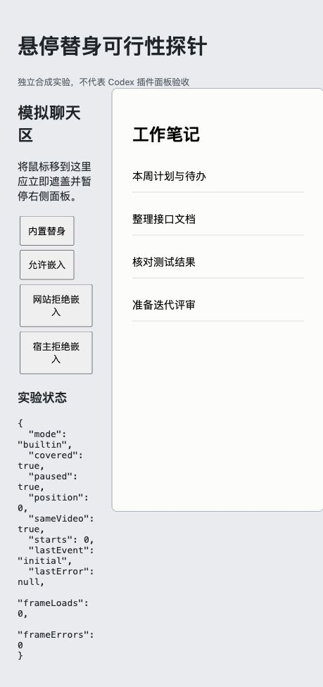
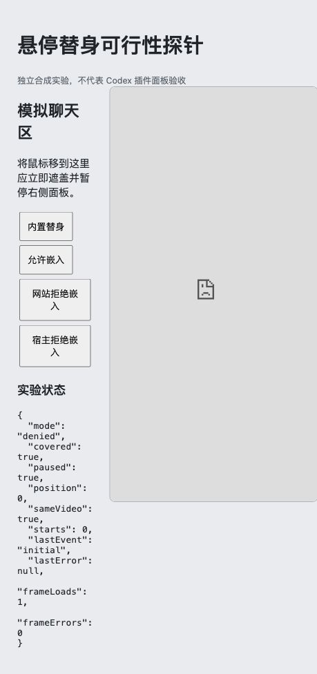
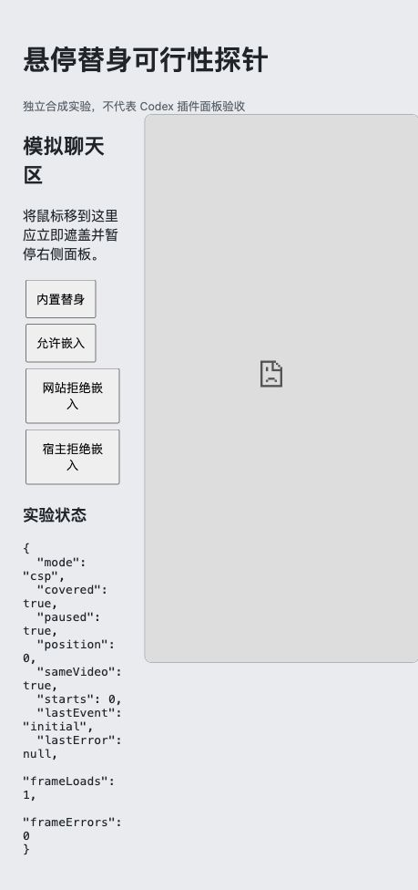

# 悬停播放与替身网页：可行性调研

日期：2026-11-08（Asia/Shanghai）

源码基线：`main` / `5033523` / 0.0.34

调研分支：`feat/hover-decoy-page`

## 结论

可以按现有播放器架构设计这项功能：鼠标移入红果播放面板显示原界面，移到聊天区或其他面板时显示替身内容；播放器实例保留，避免往返加载视频。用户已确认触发边界是**红果播放面板**。

这是方案可行性结论，尚未完成真实 Codex MCP App 的悬停移出验收。独立浏览器探针中的自动化跨 iframe 鼠标移出未得到可靠结果，不能写成已通过。

“设置中填写任意网址都能正常显示”无法保证。必须同时满足宿主的嵌入域名策略和目标网站的嵌入策略。建议默认提供内置的工作笔记页，自定义网址作为受条件限制的选项，始终保留内置替身。

本分支只添加调研报告、独立探针和证据，没有修改产品运行代码、版本、安装或发布配置。

## 需求理解与建议行为

| 场景 | 建议行为 |
| --- | --- |
| 未开启功能 | 保持现有播放行为；新开关默认关闭 |
| 开启后首次打开 | 先显示内置替身，避免连接、读取设置时闪出剧名和封面 |
| 鼠标移入播放面板 | 经过约 150 ms 防抖后显示原界面；这是设计值，尚未测得宿主实际延迟 |
| 鼠标移到聊天区等面板外 | 同步切到不透明替身并暂停，进度异步保存；隐藏路径不做淡出动画 |
| 移回面板 | 只恢复本次因遮盖而暂停的播放；原来手动暂停的保持暂停 |
| 遮盖期间任务结束或中断 | 按现有自动暂停设置处理，并撤销对应的待续播意图 |
| 切换应用、标签或隐藏页面 | 作为补充遮盖条件；重新聚焦本身不立即展示，等待新的面板内鼠标事件 |
| 自定义网站不可用 | 保留内置替身；不能仅依赖 iframe 的 load/error 回调自动判断成功 |

“移出同时暂停”是根据快速切换场景提出的建议，尚非用户已明确选定的播放策略。单纯遮盖、继续播放也能设计，但会继续出声、消耗播放进度。

遮盖范围应覆盖插件自己的品牌、选剧、封面、剧名、选集、设置和播放控件。Codex 原生标签名称、聊天中已经存在的推荐卡片由宿主管理，面板遮盖不能保证同时改变它们。

## 现有代码能复用什么

| 位置 | 现状与接入点 |
| --- | --- |
| `src/ui/player.html` | 普通面板和推荐卡片共用 HTML；可在独立根容器中切换播放器与替身，推荐卡片仅进入播放器模式后适用 |
| `src/ui/api.ts` | UI 使用 MCP Apps SDK；设置走同一套 `get_preferences` / `set_preferences`；普通分屏使用本机 HTTP 服务 |
| `src/ui/player.ts:172` | `pause()` 会增加动作序号、停止后续预加载并保存进度，可作为取消异步播放的基础 |
| `src/ui/player.ts:771` | `start()` 在多次 await 后检查动作序号；仍需增加遮盖状态检查，阻止迟到的准备结果开播 |
| `src/ui/player.ts:725` | 每约一秒同步任务状态和设置；遮盖时应继续轮询，才能及时消费 Stop/Interrupt |
| `src/ui/player.ts:1147` | 后台播放恢复存在直接 `video.play()` 路径，必须增加遮盖门禁，不能只修改播放按钮 |
| `src/ui/player.ts:970` | 当前对 `#stage` 请求全屏；真正全屏的顶层元素会盖过外部兄弟遮盖层，需要调整全屏容器或在全屏元素内提供替身 |
| `src/server/store.mjs:68` | 全局设置以 JSON 保存；添加默认字段无需新增 SQL 列，旧设置可自然补缺省值 |
| `src/server/service.mjs:61` | 设置工具的 Zod schema 需要新增开关和网址校验 |
| `src/server/index.mjs:30` | 当前 CSP 仅声明空连接域名和 `blob:` 资源，没有声明 `frameDomains` |
| `src/server/browser.mjs` | 分屏 HTTP 页使用 `default-src 'none'` 且未放行 frame-src，自定义 iframe 需要单独处理 |
| `src/ui/locale.ts` | 新设置、网址校验与失败提示需覆盖中英文 |

保留已加载的 video/HLS 实例，使用不透明覆盖层和 `inert` 隔离隐藏控件；不要把播放器导航到替身网址，也不要每次销毁再重建播放器。遮盖不应直接把 `pageActive` 置为 false。播放器仍保持挂载，用于任务状态轮询和既有的推荐抑制逻辑，避免刚遮盖就请求新的看剧推荐。

需要独立管理 `covered` 和“本次因遮盖而暂停”的恢复票据。手动暂停、选剧换集、回主页、任务停止、销毁和设置变化应使过期票据失效。所有播放入口，包括任务开始、推荐启动、连播、后台恢复和媒体系统播放键，都必须经过同一状态检查。

## 自定义网址的限制

### 宿主限制

MCP Apps 的 `frameDomains` 声明可嵌入的来源；未声明时默认不允许嵌套 iframe。当前项目依赖的 `@modelcontextprotocol/ext-apps@1.7.5` 类型中也明确描述这一行为。官方说明见 [插件 UI 参考](https://developers.openai.com/plugins/reference)。

额外只读检查了本机应用静态资源：`/Applications/ChatGPT.app`，bundle ID `com.openai.codex`，版本 `26.1103.31037`，build `25241`。其 `app.asar` 内的 `webview/assets/async/158360.69c9eb810d.js` 与 `63396.ec0c2499c7.js` 包含 `frameDomains` 的转换或上下文传递。这个静态证据支持该字段存在，不能替代具体 URL 在实际红果面板中的加载验证。

设置保存后的新域名不能通过页面脚本自行放宽现有 sandbox 的 CSP。实现时应按服务端已保存网址的精确 origin 构造资源策略，并验证重新创建面板是否能获取新策略。当前使用固定资源 URI `ui://hongguo/v19/player`，需要同时考虑宿主缓存；不能承诺保存后所有已打开面板立刻接受新域名。可以先对内置替身即时生效，域名变更提示重新打开面板，实际所需的资源版本更新/宿主重载方式仍需原型确认。

### 网站限制

即使宿主放行，目标网站仍可通过 `X-Frame-Options` 或 CSP `frame-ancestors` 拒绝加载；`frame-ancestors` 检查所有祖先，在 Codex 的多层 sandbox 中尤其需要实测。见 [MDN：frame-ancestors](https://developer.mozilla.org/en-US/docs/Web/HTTP/Reference/Headers/Content-Security-Policy/frame-ancestors)。

第三方登录、Cookie、脚本和重定向也可能使页面在 iframe 中无法正常使用。替身在鼠标移入时会消失，本身更适合作为展示内容，无需实现完整外站交互。可采用禁止脚本的 iframe sandbox、禁用 iframe 指针事件、禁止顶层跳转，并设置 `referrerpolicy="no-referrer"`；这会进一步限制依赖脚本的网站，产品应说明适用范围。

不能用 iframe `load` 等同于渲染成功，也不能指望 `error` 可靠触发。[MDN 的 iframe 事件说明](https://developer.mozilla.org/en-US/docs/Web/HTML/Reference/Elements/iframe#error_and_load_event_behavior)解释了这种限制。通用外站无法提供可信的自动成功判定；应提供显式预览、切回内置替身的入口。仅对自有、能发送就绪消息的页面才可以设计可验证的握手。

不建议为此代理和改写任意网站。那会引入脚本、资源路径、登录和隔离兼容问题，大幅扩大当前播放器的改动范围。

### 方案比较

| 方案 | 判断 |
| --- | --- |
| 内置 HTML 工作笔记页 | 推荐作为默认值；同一文档内切换，离线显示，无第三方嵌入依赖 |
| 自定义网址 iframe | 有条件可做；要求宿主放行、网站允许、页面在选定 sandbox 中能显示；域名更新和真实宿主仍待验证 |
| 用户自定义静态文本/模板 | 后续可选；对无网络、外站拒绝嵌入的情况更稳定，但不是任意在线网页 |
| 整个播放器导航到外站 | 不推荐；离开播放器后不能继续由原页面监听移回并恢复 |
| 独立原生窗口或两个 webview | 可另做研究，但涉及新的桌面外壳和平台维护，不属于当前插件的小功能 |

## 独立浏览器探针

`probe.mjs` 只读取仓库已有的 `test/fixtures/avc-aac.mp4`，监听随机本机端口，提供合成聊天区、sandbox 播放页及三个嵌入案例。它不连接红果，不读取真实观看进度、设置、凭据或其他应用日志，不属于发布产物。

运行方式（在仓库根目录）：

```sh
node docs/research/hover-decoy-2026-11-08/probe.mjs
```

打开终端显示的本机地址，结束后按 Ctrl-C。此次实验服务和临时浏览器页均已关闭。

在内置 @Browser 中观察到：

| 检查 | 结果 |
| --- | --- |
| 默认内置替身 | 工作笔记页正常显示；初始 `covered=true`、视频暂停 |
| 本地测试片播放 | 手动播放后进度实际推进，`paused=false`；仅证明独立测试页播放 |
| 两侧均允许嵌入 | 合成“项目工作台”网页正常显示 |
| 网站返回 `X-Frame-Options: DENY` | 显示 refused to connect；同时 `frameLoads=1`、`frameErrors=0` |
| 父页 `frame-src 'none'` | 显示内容被拦截；同时 `frameLoads=1`、`frameErrors=0` |
| 自动化鼠标移出 sandbox iframe | 未可靠触发子页面的移出处理；原型还不能判通过，无法据此区分输入工具路由与宿主边界事件问题 |
| 移回续播、手动暂停保持、任务结束优先、全屏遮盖 | 本次未完成验收 |
| 正式红果 Codex 面板 | 本次未修改或安装候选，也未观察正式面板悬停/播放，不计通过 |

结构化观察记录见 [observations.json](observations.json)。截图只代表独立探针：







## 建议实施顺序与验收门槛

1. 先在真实 Codex 红果面板做最小原型，只接内置替身。以实际鼠标移动验证跨 iframe 的进入/离开，包括移动到聊天区、标题栏、其他窗口、快速往返、拖动进度条的指针捕获，以及重新聚焦。`pointerleave` 语义见 [MDN](https://developer.mozilla.org/en-US/docs/Web/API/Element/pointerleave_event)；拖动中的捕获、blur、visibilitychange 和移回后的 pointermove 都需处理。
2. 接入全局开关、默认替身和统一播放门禁。在暂停、准备中、连播切集、任务开始/结束/中断期间移出，验证迟到回调不能在遮盖下开播。真实 video 保持同一实例、进度可续、手动暂停不被撤销。
3. 分别验证普通面板、从推荐卡片打开的播放器、真正全屏及 CSS 扩展全屏、内置浏览器分屏。遮盖必须在当前全屏顶层内生效，不能等异步退出全屏后才遮盖。
4. 再做自定义网址原型：精确来源声明、保存后新 sandbox 的策略、资源缓存、允许嵌入站点和拒绝站点、预览与内置回退。若真实宿主不支持可靠更新域名，应明确限制网址能力，不把它作为已完成交付。
5. 增加有意义的状态竞争回归，重点覆盖准备完成、后台重播、新回合和用户手动暂停；在实际 Codex 主窗口观察播放进度及移出/移回后行为，再决定发布。

工作量判断：内置替身属于中等规模的前端及播放状态改动；网址嵌入的主要不确定性在宿主 CSP 更新和网站兼容性；跨平台桌面验证要另计。现阶段不宜承诺“任意网址、保存立即生效”或给出未经宿主原型验证的精确工期。

本次本地检查：`node --check probe.mjs`、`git diff --check`。未修改产品代码，未运行全套安装、媒体、发布回归；这些检查也不能代替后续桌面验收。
